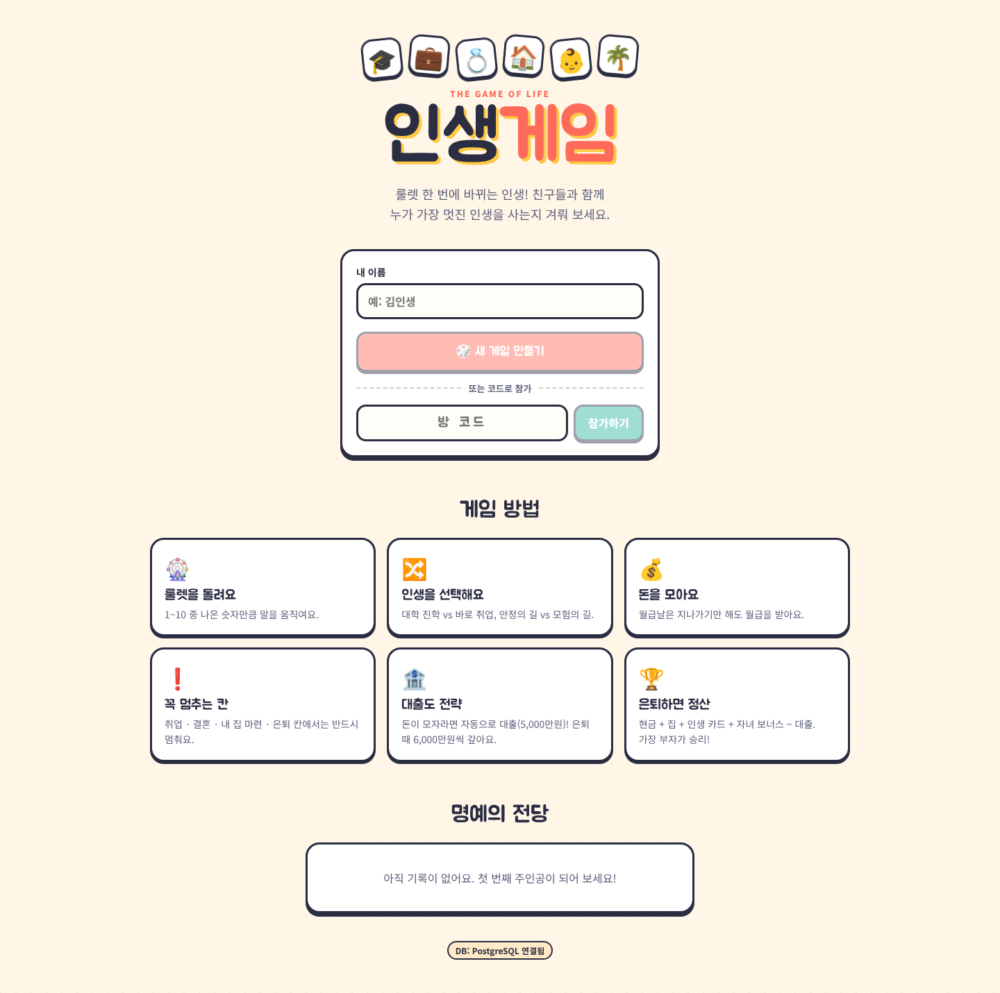
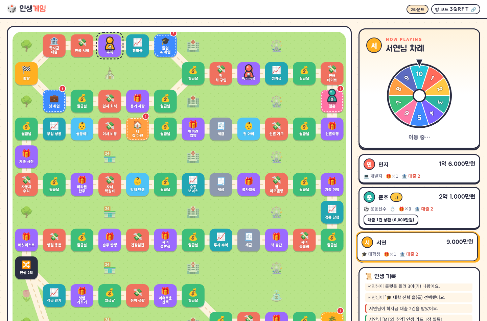
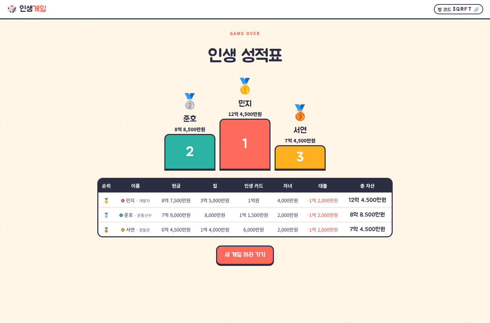

# 🎲 인생게임 웹

보드게임 "인생게임"을 웹으로 옮긴 프로젝트입니다. 방을 만들고 코드로 친구를 초대해 실시간으로 함께 플레이할 수 있어요.
한 컴퓨터에서 여러 명이 번갈아 하는 핫시트 플레이도 지원합니다.

| 홈 | 게임 | 결과 |
|---|---|---|
|  |  |  |

## 기술 스택

| 영역 | 기술 |
|---|---|
| 프론트엔드 | React 18 + TypeScript + Vite, React Router, SVG 보드/룰렛 |
| 백엔드 | Node.js + Express + TypeScript, SSE(Server-Sent Events) 실시간 동기화 |
| DB | PostgreSQL (`pg`). 설정하지 않으면 메모리 모드로 동작 |
| 테스트 | `node:test` (게임 엔진 + 무작위 게임 200판 시뮬레이션) |

## 실행 방법

```bash
npm install            # 루트 (concurrently)
npm run install:all    # 서버 + 클라이언트 의존성 설치
npm run dev            # 서버 :4000 + 클라이언트 :5173 동시 실행
```

브라우저에서 http://localhost:5173 을 열면 됩니다.

### DB 연결

1. PostgreSQL 준비
   - 로컬: `npm run db:up` (Docker 필요, docker-compose.yml 사용)
   - 클라우드: Supabase, Neon, AWS RDS 등
2. `cp server/.env.example server/.env` 한 뒤 `DATABASE_URL` 설정
   (SSL이 필요한 DB라면 `DATABASE_SSL=true`도 설정)
3. 서버를 재시작하면 로그에 `DB: postgres`가 표시됩니다.
   **테이블은 서버 시작 시 자동으로 생성돼요** (`server/db/schema.sql`)

`DATABASE_URL`이 없으면 메모리 저장소를 사용합니다. (서버를 재시작하면 데이터가 사라져요)

### 배포 (프로덕션)

```bash
npm run build   # client → client/dist, server → server/dist 빌드
npm start       # Express가 API와 프론트엔드를 한 포트(기본 4000)에서 함께 제공
```

## 한 화면 모드 (서버·DB 없이 실행)

서버 없이 브라우저만으로 돌아가는 버전이에요. 서버의 게임 엔진(`server/src/game`)을 그대로 가져다 쓰고,
한 화면에서 최대 6명이 번갈아 플레이해요. 진행 상황과 명예의 전당은 브라우저(localStorage)에 저장돼요.
온라인 멀티플레이와 DB 저장은 지원하지 않아요.

```bash
cd client
npm run build:artifact   # client/dist-artifact/life-game.html (파일 1개) 생성
```

만들어진 HTML은 Claude의 Artifact 기능으로 바로 열 수 있어요. 코드는 `client/src/local/`에 있어요.

## 프로젝트 구조

```
life-game/
├─ client/                    # 프론트엔드
│  └─ src/
│     ├─ pages/Home.tsx        # 메인 (방 만들기/참가, 게임 방법, 명예의 전당)
│     ├─ pages/Room.tsx        # 대기실 → 게임 → 결과
│     ├─ components/
│     │  ├─ BoardView.tsx      # SVG 보드 (칸, 길, 말)
│     │  ├─ Spinner.tsx        # 1~10 룰렛
│     │  ├─ ChoiceModal.tsx    # 갈림길 / 직업 / 집 선택
│     │  ├─ PlayerCard.tsx, Results.tsx, tileStyle.ts
│     ├─ hooks/useRoom.ts      # SSE 실시간 구독
│     ├─ hooks/useMoveAnimation.ts  # 룰렛 → 말 한 칸씩 이동 애니메이션
│     └─ styles.css            # 디자인 토큰(색상·폰트) + 전체 스타일
├─ server/                    # 백엔드
│  ├─ src/
│  │  ├─ game/board.ts         # 보드 구성 (칸 그래프)
│  │  ├─ game/data.ts          # 직업, 집, 금액 등 밸런스 값
│  │  ├─ game/engine.ts        # 게임 규칙 (순수 함수, 서버가 판정)
│  │  ├─ gameService.ts        # 방 단위 잠금, 저장, SSE 브로드캐스트
│  │  ├─ app.ts                # REST API 라우트
│  │  └─ db/                   # Repository 인터페이스 + Memory/Postgres 구현
│  └─ db/schema.sql
└─ docker-compose.yml          # 로컬 PostgreSQL
```

## API

| 메서드 | 경로 | 설명 |
|---|---|---|
| GET | `/api/health` | 서버 상태 + DB 모드 |
| GET | `/api/board` | 보드 데이터 |
| GET | `/api/leaderboard` | 명예의 전당 (상위 20명) |
| POST | `/api/rooms` `{name}` | 방 만들기 → `{code, playerId, token}` |
| POST | `/api/rooms/:code/players` `{name}` | 방 참가 |
| GET | `/api/rooms/:code` | 현재 게임 상태 |
| GET | `/api/rooms/:code/events` | 실시간 상태 스트림 (SSE) |
| POST | `/api/rooms/:code/start` | 게임 시작 (방장만) |
| POST | `/api/rooms/:code/actions` | `spin` / `choosePath` / `chooseCareer` / `buyHouse` / `repayLoan` |

플레이어 인증은 `x-player-token` 헤더로 합니다. 토큰은 참가할 때 발급되어 브라우저 localStorage에 저장돼요.

## DB 스키마

- `games`: 방별 게임 상태(JSONB) + `version` (낙관적 잠금으로 동시 요청 충돌 방지)
- `game_results`: 게임이 끝나면 플레이어별 최종 결과 저장 (명예의 전당에 사용)

## 게임 규칙

- 룰렛(1~10)을 돌려 나온 수만큼 이동. **월급날**은 지나가기만 해도 월급을 받아요
- 첫 갈림길: **대학 진학** (학자금 대출 2건, 고연봉 학위 직업 선택 가능) vs **바로 취업**
- 두 번째 갈림길: **안정의 길** vs **모험의 길** (투자 칸에서 한 번 더 돌려 6 이상이면 대박, 아니면 손실)
- **반드시 멈추는 칸** (빨간 `!` 표시): 첫 취업, 졸업, 결혼, 내 집 마련, 은퇴
- 현금이 모자라면 자동으로 대출(건당 +5,000만원), 은퇴 정산 때 건당 6,000만원 상환
- 은퇴 보너스: 1등 +1억, 2등 +5,000만원, 3등 +2,000만원
- **최종 자산** = 현금 + 집 판매가 + 인생 카드 + 자녀 보너스(1명당 2,000만원) − 대출

밸런스(연봉, 집값 등)는 `server/src/game/data.ts`, 보드 칸은 `server/src/game/board.ts`에서 수정하면 됩니다.

## 참고 / 확장 아이디어

- 실시간 동기화는 서버 1대 기준으로 설계했어요. 여러 대로 운영하려면 SSE 브로드캐스트를 Redis Pub/Sub 등으로 바꿔야 합니다.
- 아이디어: 로그인/계정, 채팅, 보드 이벤트 추가(소송, 보험 등), 효과음
